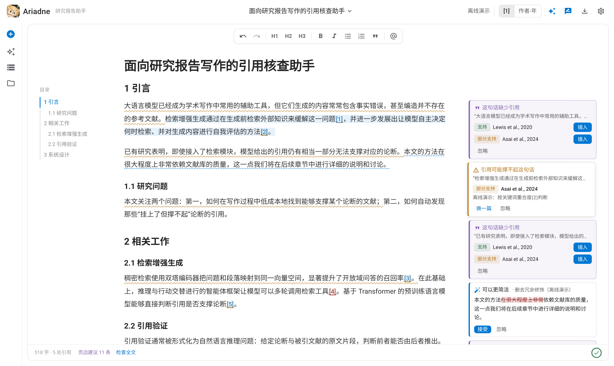
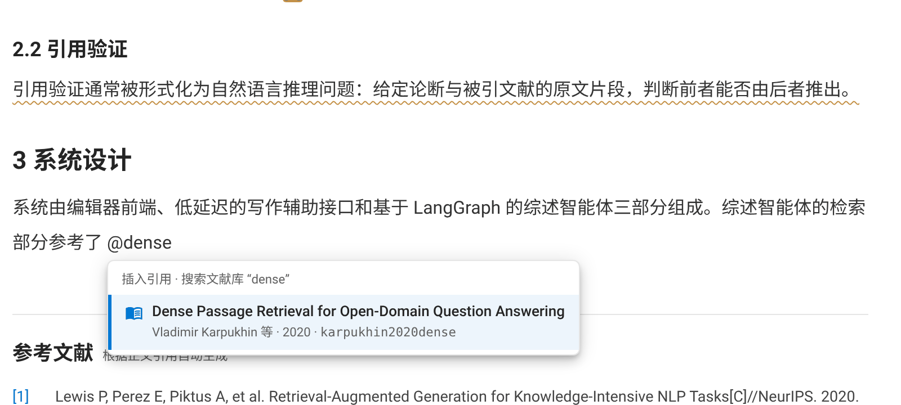
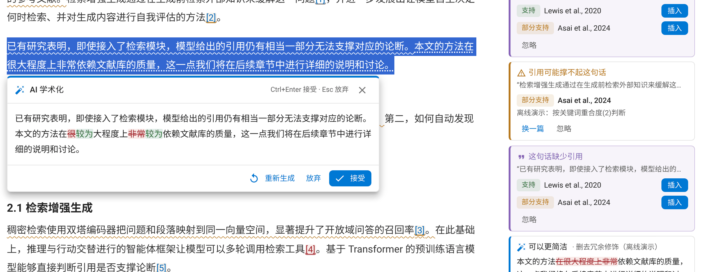
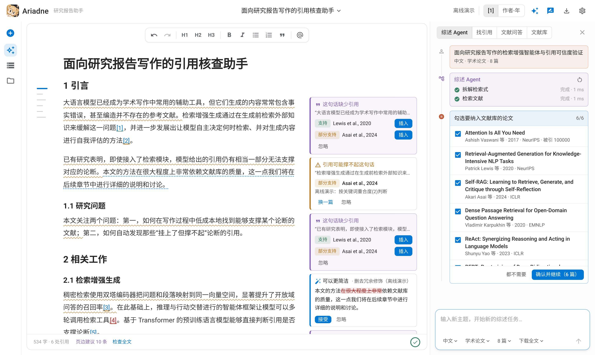
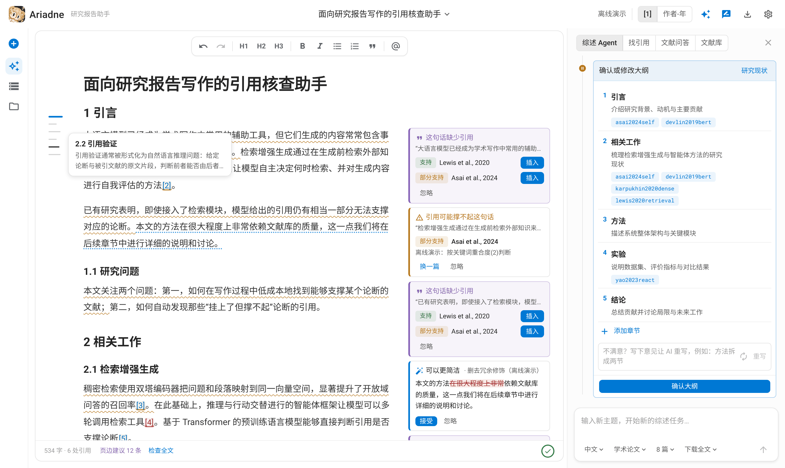
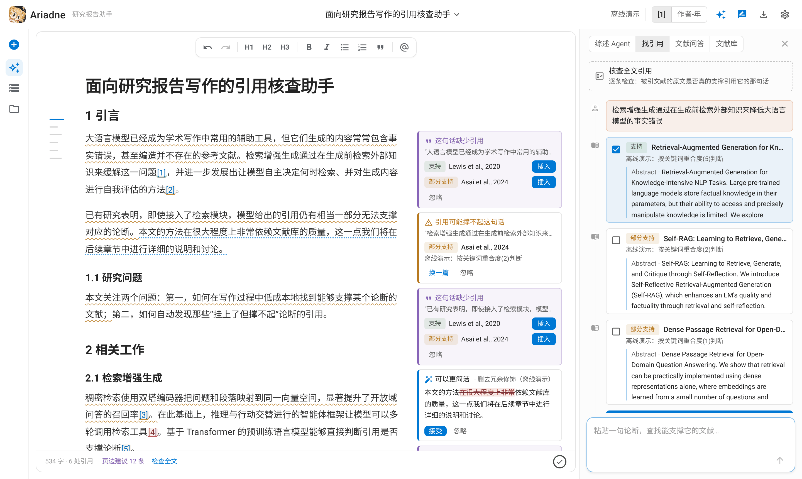
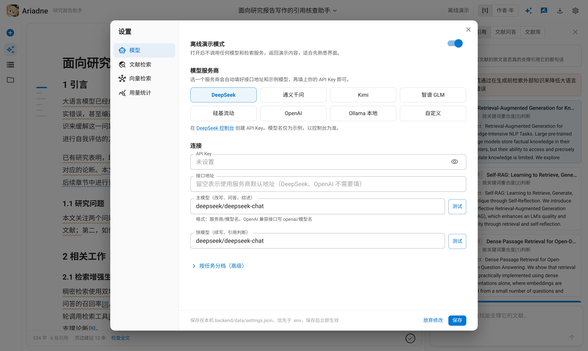
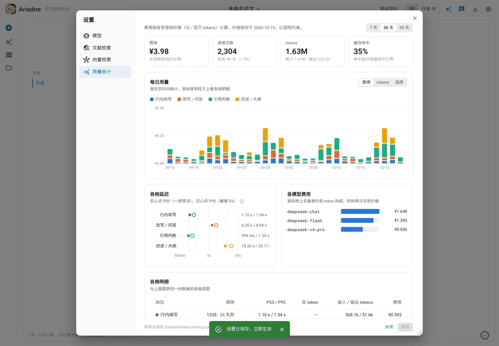
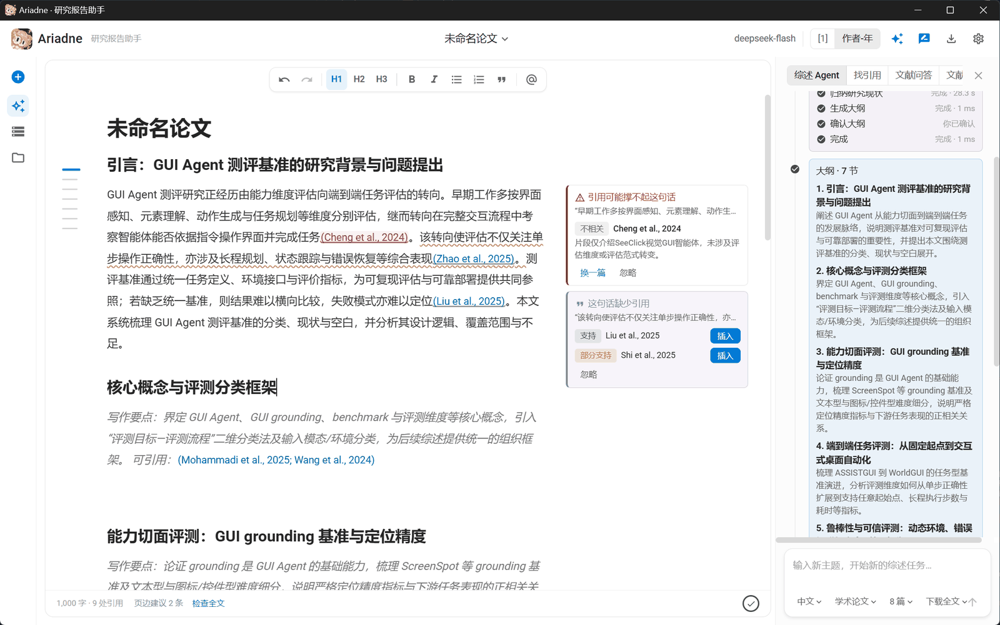

# Ariadne · 研究报告助手

<p align="center"></p>

<p align="center">
  <a href="https://github.com/tkzzzzzz6/Ariadnian-Agent/actions/workflows/ci.yml"></a>
  <a href="https://github.com/tkzzzzzz6/Ariadnian-Agent/releases"></a>
</p>

Ariadne 是一个帮你**快速走进一个陌生研究领域**的研究报告写作助手。它不替你写，而是把「读懂一个领域」拆成三步，让理解留在你自己脑子里：

1. **AI 检索，搭出骨架**：输入感兴趣的主题，综述 Agent 检索论文、提炼要点，给出一份带出处的大纲。
2. **你来审阅，形成理解**：Agent 在「选哪些文献」「大纲怎么定」两处停下来等你确认。逐篇取舍、改写大纲的过程，就是你理清这个领域脉络的过程。
3. **边写边纠错，加深记忆**：动手写作时有续写、改写和 `@` 插入引用帮忙；页边批注会核查每一处引用是否真的被原文支撑、指出缺少依据的论断。被指出过的错误，往往记得最牢。

**你自己写，AI 在旁边帮忙**，每一处引用都能追溯到原文。

> 名字来自阿里阿德涅之线 —— 在文献的迷宫里牵一根线，每一处引用都能追溯到原文。



## 功能

| 功能 | 怎么用 | 实现要点 |
|---|---|---|
| **行内续写建议** | 停顿约 0.7 秒出现灰色建议；`Tab` 接受，`Ctrl+→` 接受一个词，`Esc` 忽略 | 防抖 + AbortController 取消过期请求；走快模型，不经过 Agent |
| **选中改写** | 选中文字 → 润色 / 学术化 / 改写 / 扩写 / 精简 / 译英 / 译中 / 自定义 | 流式输出，修订模式 diff，逐次接受或放弃；改写时保留引用标记 |
| **插入引用** | 正文输入 `@` 搜索文献库；或文献库条目上的 ❞ 按钮 | 引用是独立的 citation 节点，绑定文献库 id |
| **为一句话找引用** | 选中文字，在浮动菜单里点「找引用」 | 混合检索 + LLM 判断「支持 / 部分支持 / 不相关」，并给出原文片段 |
| **页边批注** | 默认开启（顶栏 ✎ 图标切换）；写完一段、光标离开后自动检查 | 逐段调用 `/api/assist/annotate`：核查已有引用、找出缺引用的论断并给出候选文献、至多一条精简建议；结果按段落内容缓存，正文用波浪线/虚线标出，卡片与句子对齐 |
| **整篇引用核查** | 助手抽屉「找引用」→ 核查全文引用 | 逐条检查被引文献原文能否支撑那句话，能找出凭空挂上的引用 |
| **参考文献自动生成** | 无需操作 | 顺序编码（GB/T 7714 简化）/ 作者-年份（APA）一键切换 |
| **文献库** | 在线检索 Semantic Scholar / arXiv / OpenAlex、上传 PDF、下载开放获取全文 | PyMuPDF 解析，按章节切块（记录章节和页码），遇到参考文献就停止 |
| **文献问答** | 助手抽屉「文献问答」 | 回答带 [n] 来源，可一键插入正文并自动转换成引用 |
| **综述 Agent** | 助手抽屉「综述 Agent」填主题 → 勾选文献 → 修改/确认大纲 → 写入文档 | LangGraph + `interrupt()` 人工确认 + SQLite checkpointer（刷新页面、重启服务都能恢复） |
| **导出** | 顶栏「导出」 | LaTeX + refs.bib（可直接传 Overleaf）、Markdown（pandoc 引用语法）、BibTeX |
| **用量统计** | 设置 →「用量统计」 | 每次调用记录耗时、首 token、token 数和缓存命中；按 DeepSeek / Kimi 官网价格折算人民币（含 DeepSeek 高峰分时价和缓存价），其他模型可在页面里填单价；展示每日趋势、各档 P50/P95 延迟和各模型费用 |

**防止编造引用**是贯穿各个功能的原则：大纲里的 bibkey 会和文献库核对，库里没有的直接丢弃；改写结果里的 `[@key]` 只有在文献库中存在才会变回引用；引用核查会对照被引文献的原文逐条检查。

## 界面

> 以下截图来自系统实际运行画面，在**离线演示模式**（`npm run demo`，`LLM_FAKE=1`）下拍摄：界面和操作流程是真实的，文献元数据是真实论文，但 AI 给出的判断、改写和大纲是演示数据（卡片上标有「离线演示」）。接入模型后内容由模型生成。

**页边批注**（见页首截图）：停笔后逐段检查，缺引用的论断、可能撑不起论断的引用、可以精简的句子直接贴在段落旁边，一键插入候选文献或接受改写。

<table>
<tr>
<td width="50%"><b>@ 插入引用</b>：正文里输入 <code>@</code> 搜索文献库<br/></td>
<td width="50%"><b>选中改写</b>：修订模式显示增删，接受或放弃<br/></td>
</tr>
</table>

**综述 Agent**：输入主题后检索文献，在「勾选文献」和「确认大纲」两处停下来等你确认；打开抽屉时左侧目录缩成短横线，鼠标移上去即可预览章节。

<table>
<tr>
<td width="50%"></td>
<td width="50%"></td>
</tr>
<tr>
<td><b>找引用</b>：为一句论断检索文献，给出「支持 / 部分支持」判断和原文片段<br/></td>
<td><b>设置</b>：在网页里选模型服务商、填 API Key、测试连接，无需改 .env<br/></td>
</tr>
</table>

**用量统计**：每次模型调用都会记账。按官网价格折算成人民币，并展示每日费用、各档延迟（P50 一般情况 / P95 最慢 5%）和各模型的花费；没有内置价格的模型，可以直接在页面上填写单价。（截图中的调用数据为模拟数据）



正文始终在视野中心；目录悬浮在左侧页边，打开抽屉或窗口变窄时缩成一列短横线（1/2/3 级标题长短不同，当前章节蓝色高亮，鼠标移上去立即预览标题和正文开头，点击跳转）；AI 助手平时收起，左侧图标栏或 `Ctrl+J` 打开。

## 架构

<p align="center"></p>

<details>
<summary>文字版（模块与接口）</summary>

```
frontend/  React 19 + Vite + MUI 7 + TipTap 3
  ├─ 编辑器：Citation 节点 / @ 引用建议 / GhostText 续写 / 选区浮动菜单 + diff / 悬浮目录
  ├─ 页边批注：段落 hash 缓存 → /api/assist/annotate → 正文装饰（ReviewMarks）+ 对齐的卡片
  └─ 助手抽屉：综述 Agent · 找引用 · 文献问答 · 文献库 · 我的论文
        │   /api（开发时由 Vite 代理）
        ▼
backend/   FastAPI
  ├─ LLM 接入层 llm.py：LiteLLM，四档模型 complete / write / judge / agent，各自的超时、重试、备用模型，调用日志
  ├─ 快速路径（直接调用 LLM，低延迟）：/api/assist/complete · edit(SSE) · cite · verify · annotate · ask(SSE)
  ├─ Agent 路径：/api/agent/start · /{id}/resume（SSE） → LangGraph
  │     plan_queries → search_papers → select_papers⏸ → ingest → synthesize → make_outline → review_outline⏸ → finish
  │                                                                              ▲──────── regenerate ────────┘
  └─ 共享：SQLite（文献、切块、文档）· BM25(jieba) + 可选向量的 RRF 混合检索 · 跨语言查询扩展
```

</details>

为什么把两条路径分开：续写、改写这些操作要求几百毫秒内响应，直接调用模型；综述这类长任务要中途暂停、等用户确认、断点续跑，这部分交给 LangGraph。

## 快速开始

需要 [uv](https://docs.astral.sh/uv/getting-started/installation/)（Windows 可用 `winget install astral-sh.uv`）和 Node.js ≥ 20。所有命令都在仓库根目录执行：

```bash
npm run setup     # 第一次：安装前后端依赖，并生成 backend/.env
npm run dev       # 开发：后端 :8000 + 前端 :5173 一起启动，热更新，自动打开浏览器，Ctrl+C 一起退出
```

| 命令 | 作用 |
|---|---|
| `npm run setup` | `uv sync` + `npm install`，没有 `backend/.env` 时从 `.env.example` 生成 |
| `npm run dev` | 开发模式，前后端同时启动 |
| `npm run demo` | 同上，但设置 `LLM_FAKE=1`：不调用模型、不需要 API key，适合演示和调界面 |
| `npm start` | 生产模式：前端有改动才重新构建，由后端单端口提供服务 http://localhost:8000 |
| `npm test` | 后端测试（24 个，离线）+ 前端类型检查 |
| `npm run eval` | 测评引用判断、假引用检出、检索、缺引用检测和续写延迟，见下文「测评」 |
| `npm run desktop` | 打包 Electron 桌面版（见下文「桌面版」）；加 `-- --dev` 则不打包、直接用桌面窗口运行 |

依赖没装时 `dev` / `demo` / `start` 会自动先执行一次 `setup`。设置环境变量 `NO_OPEN=1` 可以不自动打开浏览器，`PORT` 可以修改 `npm start` 的端口。

## 桌面版

不想开命令行和浏览器的话，可以打包成桌面程序：双击打开就是一个独立窗口，关掉窗口就完全退出。技术路线和 Claude、Codex 的桌面端一样，用 **Electron 外壳 + 独立的后端进程**。



<p align="center"><sub>Windows 桌面版实际运行：综述 Agent 生成的大纲在右侧，页边批注标出了一处撑不起论断的引用和一处缺引用的句子</sub></p>

```bash
npm run desktop          # 构建前端 → PyInstaller 打包 Python 后端 → electron-builder 生成安装包
npm run desktop -- --dev # 不打包，直接用 Electron 窗口运行当前源码（调试用）
```

- **下载**：每次发布版本时，CI 会自动打包并上传到 [Releases](https://github.com/tkzzzzzz6/Ariadnian-Agent/releases)，直接下载安装即可。
- **产物**（在 `desktop/dist/`）：Windows 为 `Ariadne-Setup-<版本>.exe` 安装程序和免安装 zip；macOS 为 dmg；Linux 为 AppImage。只能打包当前系统的版本，跨平台由 CI 分别打包。
- **数据位置**：文献库、论文、设置保存在 `%APPDATA%\Ariadne`（macOS 为 `~/Library/Application Support/Ariadne`），卸载或升级都不会删除。日志在其中的 `logs/`（`electron.log`、`server.log`）。它和 `npm run dev` 用的 `backend/data` 是分开的，想沿用已有的文献库，把 `backend/data` 里的文件复制过去即可。
- **工作方式**：Electron 主进程（`desktop/electron/main.js`）先显示启动页，分配一个空闲端口，启动打包好的后端 `ariadne-server`（`desktop/server.py`，只监听 `127.0.0.1`），等健康检查通过后加载页面。同一时间只运行一个实例；关闭窗口时结束后端，后端也会在 Electron 意外退出后自行退出。外部链接用系统浏览器打开，导出文件弹出「另存为」。
- **为什么是 Electron**：编辑器重度依赖可编辑区域、选区和输入法，Electron 在所有平台上都是同一个 Chromium 内核，表现一致；Tauri 和 pywebview 用的是系统 WebView，在 macOS（WebKit）和 Linux（WebKitGTK）上需要分别适配。
- **体积**：安装包约 250 MB，其中 Python 后端（LiteLLM、PyMuPDF、numpy 等）约占四分之三。
- **下载加速**：本地打包时 Electron 相关的二进制默认从 npmmirror 镜像下载；设置 `CI=1` 时改用官方源。
- **首次运行提示**：安装包没有代码签名，Windows 可能提示「Windows 已保护你的电脑」，点「更多信息 → 仍要运行」即可。

## CI/CD

GitHub Actions 配置在 `.github/workflows/`：

| 工作流 | 触发 | 做什么 |
|---|---|---|
| `ci.yml` | 每次 push / PR | 后端单元测试（Ubuntu + Windows）、测评冒烟（离线）、前端类型检查与构建 |
| `release.yml` | 推送 `v*` 标签 | 在 Windows、macOS、Linux 上分别打包桌面版，自动创建 Release 并上传安装包；也可以手动运行，只打包不发布 |
| `eval.yml` | 手动 | 用真实模型跑测评，结果写进运行摘要并保存为 Artifact；需要在仓库 Secrets 里添加 `LLM_API_KEY` |

发布新版本：

```bash
git tag v0.2.0
git push origin v0.2.0
```

几分钟后 Releases 页面会出现 `Ariadne-Setup-0.2.0.exe`、`Ariadne-0.2.0-mac-arm64.dmg`、`Ariadne-0.2.0-linux-x86_64.AppImage`。CI 上安装 Python 依赖时用官方 PyPI（仓库默认的清华镜像只在本地生效）。

Release 说明由 GitHub 自动生成，分类规则写在 `.github/release.yml`。它按 **PR label** 分章节，不解析 commit 前缀 —— 想让更新说明分出「新功能 / 缺陷修复 / 文档 / 构建」，给 PR 打上 `feature`、`bug`、`documentation`、`ci` 等 label 即可，没打 label 的会落到「其他变更」。

## 配置要点

**推荐在网页里配置**：右上角 ⚙ 打开「设置」，可以配置模型（选服务商预设、填 API Key、主模型和快模型，高级里还能按四档分别配置）、文献检索（Semantic Scholar / OpenAlex 的 key、默认来源、缓存天数）、向量检索，并查看各档模型的用量统计。每一项都有「测试」按钮，保存后立即生效，不用重启。

- 网页里保存的设置写在本机 `backend/data/settings.json`，**优先于 `.env`**；网页里没设置的项继续读 `.env`，所以原来的 `.env` 配置照样可用。
- API Key 只写不读：接口只返回是否已设置和末 4 位，测试失败时报错信息里的 key 也会被遮住。
- 第一次打开、还没配置模型时，会自动弹出设置页。

也可以继续用 `.env`（适合部署或脚本化），字段说明见 `backend/.env.example`：

- **模型（LiteLLM）**：模型名写成 `provider/model`，例如 `deepseek/deepseek-chat`、`openai/qwen-plus`（OpenAI 兼容服务，需同时填 `LLM_API_BASE`）、`ollama_chat/qwen2.5:7b`，Claude、Gemini 等原生接口也能用。按任务分四档：

  | 档位 | 环境变量 | 用途 | 默认超时 |
  |---|---|---|---|
  | complete | `MODEL_COMPLETE` | 行内续写，延迟最敏感 | 8 s，不重试 |
  | write | `MODEL_WRITE` | 选中改写、文献问答 | 90 s |
  | judge | `MODEL_JUDGE` | 引用判断、中文→英文检索关键词 | 30 s |
  | agent | `MODEL_AGENT` | 综述与大纲（JSON 输出） | 180 s |

  没单独配置的档位使用 `MODEL_ID` / `FAST_MODEL_ID`。每档还可以配置 `_API_KEY`、`_API_BASE`、`_TIMEOUT`、`_FALLBACKS`（备用模型）。旧版的 `MODEL_PROVIDER` + `OPENAI_API_KEY` + `OPENAI_BASE_URL` 配置仍然有效。每次调用的耗时、首 token 延迟、token 数和费用都会记录下来，在右上角「模型设置」里查看（接口为 `/api/llm/stats`）。
- **中文写作 + 英文文献**：系统会把中文句子转换成英文关键词，再和原句一起检索。条件允许的话，建议再开启多语言向量模型（例如 `EMBEDDING_PROVIDER=ollama`、`EMBEDDING_MODEL=bge-m3`）。
- **学术检索与限流**：Semantic Scholar 不配 key 时与所有匿名用户共享配额，高峰期经常返回 429，强烈建议免费申请 `SEMANTIC_SCHOLAR_API_KEY`。检索层会自动处理：同一来源的请求限速（S2 每秒 1 次、arXiv 3 秒 1 次），429/5xx 按 Retry-After 或指数退避重试 3 次，仍失败就冷却 60 秒并改用 OpenAlex 补位（可选 `OPENALEX_API_KEY`），结果缓存 7 天（`SEARCH_CACHE_DAYS`）。

## 测评

`npm run eval` 用网页里配置的模型跑一遍测评，结果写进 [`backend/evals/results/`](backend/evals/results/README.md)，换模型或改 prompt 之后可以直接对比。测的都是系统里真实在用的函数：

| 测评 | 数据 | 关键指标 |
|---|---|---|
| 引用判断 | SciFact 209 对论断—证据（英文），以及中文论断 + 英文原文 | 准确率、**假支持率**（撑不起的证据被判成“支持”） |
| 假引用检出 | 把正确引用换成随机文献 / 主题相近的难例文献 | 检出率、正确引用误报率 |
| 检索 | 1,489 段语料，英文 / 中文 / 中文 + 跨语言关键词扩展 | Recall@5、MRR |
| 缺引用检测 | 20 段中文研究报告、72 句逐句标注 | Precision / Recall / F1 |
| 延迟与花费 | 20 次行内续写 + 本次全部模型调用 | P50 / P95、token、花费 |

当前结果（全量数据；离线基线不调用模型，只用关键词规则 + 纯 BM25）：

| 运行 | 引用判断准确率 | 假支持率 ↓ | 假引用检出（随机 / 难例） | 正确引用误报 ↓ | 检索 R@5（英文 / 中文 / 中文+扩展） | 缺引用 F1 |
|---|---|---|---|---|---|---|
| 离线基线 | 56.9% | 50.7% | 85.5% / 0.0% | 4.3% | 84.7% / 26.7% / — | 34.8% |
| deepseek-flash（推理模型） | 67.0% | **0.0%** | 100% / **91.3%** | 8.7% | 84.7% / 26.7% / 53.3% | **83.0%** |
| deepseek-chat | **75.1%** | 5.6% | 100% / **91.3%** | 10.9% | 84.7% / 26.7% / **86.7%** | 73.3% |

- **模型判断远好于规则**：关键词规则会把一半撑不起论断的证据判成“支持”、主题相近的难例假引用一条都标不出；两个模型的难例检出都是 91%。
- **跨语言扩展效果明显**：中文论断直接检索英文文献 Recall@5 只有 26.7%，用 deepseek-chat 生成英文关键词后达到 86.7%，与英文论断（84.7%）持平。
- **两个模型各有取舍**：deepseek-chat 判断更准（中文论断 83.8%）、续写 P50 0.78 秒，但 71 条撑不起的证据里有 4 条被判成“支持”；deepseek-flash 一条都不放过，但更保守（正确引用一半出黄色提示），而且作为推理模型，续写慢一倍、关键词扩展有一半因思考耗尽额度而为空。默认推荐续写和引用判断两档用 deepseek-chat。

完整对比表见 [backend/evals/results](backend/evals/results/README.md)。

各项定义、数据来源和局限见 [backend/evals/README.md](backend/evals/README.md)。

## 目录

```
backend/
  app/
    main.py            FastAPI 入口
    routers/settings.py  网页设置：读取 / 保存（settings.json 覆盖 .env）、测试模型连接与检索来源
    config.py          .env 配置（兼容旧版字段）
    llm.py             LiteLLM 接入层：四档模型、JSON 模式、备用模型、调用统计、LLM_FAKE
    db.py              SQLite 表结构
    library.py         文献元数据、去重、bibkey、BibTeX
    ingest.py          PDF 解析与按章节切块
    retrieval.py       BM25 + 向量 RRF 混合检索
    embeddings.py      可选嵌入（Ollama / OpenAI）
    scholar.py         Semantic Scholar / arXiv / OpenAlex 检索：限速、429 重试、自动补位、结果缓存；PDF 下载
    assist.py          续写、改写、找引用、核查、问答
    agent/graph.py     LangGraph 综述→大纲工作流
    routers/           API 路由
  evals/             测评：数据、任务、指标，结果存在 evals/results/
  tests/
package.json         一键命令（setup / dev / demo / start / test / eval / desktop）
scripts/             启动脚本，只用 Node 内置模块，Windows / macOS / Linux 通用
desktop/             桌面版：Electron 外壳（electron/）、后端入口 server.py、PyInstaller 配置
.github/workflows/   CI（测试、构建）、Release（三平台打包发布）、模型测评
docs/                架构图（gen_architecture.py 生成）、界面截图、布局草图（layouts/）
frontend/
  src/
    editor/            TipTap 编辑器与扩展（引用节点、@ 引用、灰色续写、选区改写、页边批注、悬浮目录）
    panels/            右侧抽屉：综述 Agent / 找引用 / 文献问答 / 文献库 / 我的论文
    components/        时间线卡片、输入框、设置页（模型 / 文献检索 / 向量检索 / 用量）
    lib/               API、引用格式化、导出、页边批注的段落缓存与定位
```

## 路线图

- [ ] 分节写作 Agent：按大纲逐节生成草稿，每节单独检索，写完自动跑一遍引用核查
- [ ] 审稿 Agent：模拟审稿人挑逻辑和论据问题，带有限轮次的修改循环
- [x] 测评：引用判断、假引用检出、检索、缺引用检测、延迟与花费
- [ ] 测评扩展：更多学科的中文段落、全文片段级的引用核查、端到端写作任务
- [ ] GROBID / MinerU 解析，提升双栏排版和中文 PDF 的解析质量
- [ ] docx 导出（pandoc）、图表与公式节点
